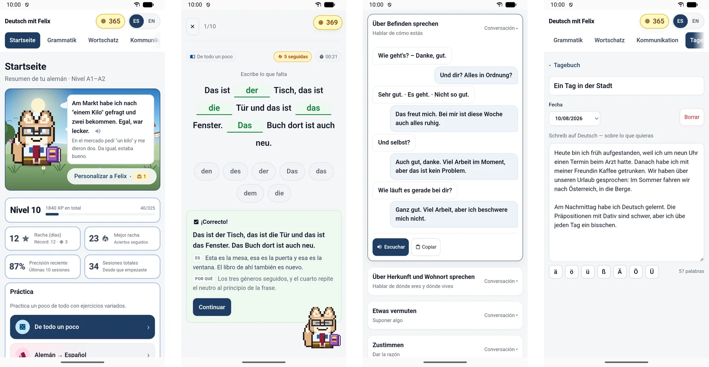

# Deutsch Trainer · *Deutsch mit Felix*

A German-learning app for A1–B1 learners, built because I needed one while learning German
in Vienna. It runs in the browser, and an offline Android version, *Deutsch mit Felix*,
works without any server in Spanish, English, Ukrainian and Turkish.



## What it does

- **Grammar** organised by topic, each split into **theory** (rules, a summary table, typical
  mistakes, German examples with translations) and **exercises**: multiple choice with plausible
  distractors, sentence ordering, gap fills.
- **Never the same exercise twice:** items are generated from templates with slots and
  vocabulary banks. Each session mixes new items with a simple **spaced-repetition** review of
  the concepts you get wrong.
- **Feedback that explains:** after every answer, the full sentence, its translation and *why*.
  The session summary groups mistakes by rule and shows accuracy, time and XP.
- **Vocabulary** cards and mini-games, with **import from Excel** (for example an export from
  Language Reactor).
- **Kommunikation:** everyday dialogues to read, listen to and practise.
- **Diary (Tagebuch)** and a **class notebook** for writing practice.
- **Motivation:** daily XP goal, streaks with freezes, a local leaderboard, and Felix, a pixel-art fox.
- **Optional AI** (the web version only, with your own Gemini or OpenAI-compatible key):
  exercises generated on the spot around your weak points, and longer explanations. Without a
  key, everything above still works from templates.

## Tech

React + Vite · plain JavaScript modules per grammar topic · local storage behind one storage
layer (so syncing can be added later) · Capacitor for the Android build · Gemini API for the
optional AI features · built with Claude Code.

```
src/
  lib/         storage, streaks, progress (spaced repetition), leaderboard, settings, ai
  engine/      item helpers and the session generator
  topics/      one module per topic: theory + concepts + "frames" that generate exercises
  components/  dashboard, grammar, session, exercise types, feedback, summary, settings
```

Adding a topic means writing `src/topics/<topic>.js` with `theory`, `concepts` and `frames`
and registering it in `src/topics/index.js`.

## Run

```bash
npm install
npm run dev          # http://localhost:5180
npm run portable     # a single ~2 MB "Deutsch Trainer.html" that opens offline with a double click
```

The portable file keeps grammar, vocabulary, mini-games, Kommunikation and streaks; the AI
features need a server and are left out.

## Languages

The interface is translated; the German being practised never is. How translations are
organised, and the checks used to keep them consistent, are in [TRADUCCION.md](TRADUCCION.md)
(in Spanish).

---

Alvar Pascual García · [alvar56.github.io](https://alvar56.github.io)
